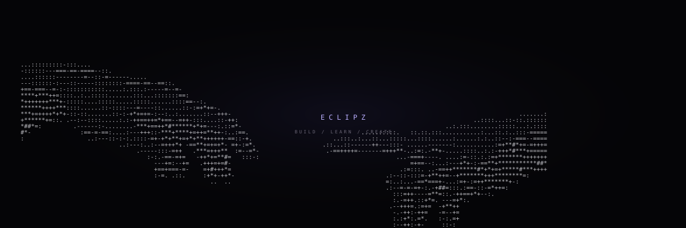

<div align="center">



<br>

# eclipz

`developer • creator • builder`

<sub>turning random ideas into things that actually exist.</sub>

<br><br>

<a href="https://github.com/EclipZexe?tab=repositories"></a>
<a href="https://github.com/EclipZexe/portfolio"></a>


</div>

---

## `01 / about`

<table>
<tr>
<td width="60%" valign="top">

I'm **eclipz**, a developer from **Guadeloupe**.

I build websites, automation tools, bots, desktop experiments and AI-powered projects. Most of them start as something I want for myself and slowly become much bigger than planned.

Right now I'm focused on making things that feel **useful, personal and visually different** instead of just shipping another generic app.

</td>
<td width="40%" valign="top">

```js
const eclipz = {
  location: "Guadeloupe",
  status: "building",
  focus: [
    "web",
    "python",
    "automation",
    "ui / ux",
    "ai"
  ]
}
```

</td>
</tr>
</table>

---

## `02 / stack`

<div align="center">


</div>

<br>

<div align="center">

`python` · `javascript` · `typescript` · `html` · `css` · `node.js` · `git`

</div>

---

## `03 / selected work`

<table>
<tr>
<td width="50%" valign="top">

### [portfolio](https://github.com/EclipZexe/portfolio)

My personal corner of the internet.

Interactive visuals, project showcases, music stats, a guest wall and whatever else gets added next.

`web` `design` `experiments`

</td>
<td width="50%" valign="top">

### [Vesper](https://github.com/EclipZexe/Vesper)

An ongoing project built to evolve instead of staying a one-off experiment.

`development` `experiments`

</td>
</tr>
<tr>
<td width="50%" valign="top">

### [botty](https://github.com/EclipZexe/botty)

An all-in-one Discord bot project with verification, moderation, themed server templates and a web dashboard.

`discord` `automation` `bots`

</td>
<td width="50%" valign="top">

### experiments

Small tools, unfinished ideas and weird interfaces that don't need their own category yet.

`whatever looks interesting`

</td>
</tr>
</table>

---

## `04 / github`

<div align="center">


<br>


</div>

---

## `05 / activity`

<div align="center">


</div>

---

## `06 / currently`

```txt
building     █████████░  probably too much
learning     ████████░░  always
sleeping     ██░░░░░░░░  questionable
ideas        ██████████  unlimited
```

<div align="center">

<sub>`made from guadeloupe`</sub>

<br><br>

`build / learn / create / repeat`

</div>
