 

  

 

## 01 / ABOUT ME

<table>
<tr>
<td width="62%" valign="top">

### Hey, I'm Gabriel — online as **3clipz**.

*3clipz* is pronounced **“eclipse.”** I’m a developer and computer enthusiast from **Guadeloupe**, building under the EclipZ name.

I like making digital things feel intentional: websites, dashboards, Discord bots, automation, and interfaces with personality. I’m just as curious about what’s inside a computer as what’s on the screen.

When I’m not building software, I’m usually interested in **PC building, cleaning, troubleshooting, maintenance, and repair**. I enjoy watching satisfying PC-cleaning videos and figuring out how the parts fit together—and how to get better at building and fixing systems myself.

My rule: **build it, understand it, improve it, repeat.**

</td>
<td width="38%" valign="top">

~~~js
const threeClipz = {
  name: "Gabriel",
  alias: "3clipz",
  pronunciation: "eclipse",
  home: "Guadeloupe",
  interests: [
    "software development",
    "PC building",
    "PC repair",
    "UI and design",
    "Discord tools"
  ],
  mindset: "always learning"
};
~~~

</td>
</tr>
</table>

---

## 02 / WHAT I'M INTO

<table>
<tr>
<td width="50%" valign="top">

### Software & digital products

- Personal websites and interactive experiences
- Dashboards, tools, and automation
- Discord bots and integrations
- UI/UX, design systems, and desktop concepts

</td>
<td width="50%" valign="top">

### PCs & hardware

- Learning PC component compatibility
- Building, maintaining, and troubleshooting systems
- PC cleaning and repair
- Understanding how to make a setup cleaner, smarter, and more reliable

</td>
</tr>
</table>

---

## 03 / TOOLBOX

  

 

Tools are part of the journey. The goal is to keep learning how to use them well.

---

## 04 / SELECTED WORK

<table>
<tr>
<td width="50%" valign="top">

### [Portfolio ↗](https://github.com/EclipZexe/portfolio)

My personal corner of the internet: an evolving space for projects, interactive visuals, music stats, a guest wall, and ideas that deserve a home.

**Focus:** web · interaction · personal identity

</td>
<td width="50%" valign="top">

### [Botty ↗](https://github.com/EclipZexe/botty)

A Discord bot project exploring useful server tools, including verification, moderation, server templates, and a dashboard.

**Focus:** Discord · automation · product thinking

</td>
</tr>
<tr>
<td width="50%" valign="top">

### PC projects

Learning by getting closer to the hardware: component choices, cleaning, repair, troubleshooting, and building better systems.

**Focus:** hardware · maintenance · problem-solving

</td>
<td width="50%" valign="top">

### eclipz.dev

The home for my identity and work online—designed to grow alongside the projects, experiments, and skills I build.

**Focus:** web · design · motion · personal brand

</td>
</tr>
</table>

---

## 05 / DISCORD PRESENCE

 

Powered by <a href="https://github.com/cnrad/lanyard-profile-readme">Lanyard</a>. Live status appears when my Discord account is available to Lanyard.

---

## 06 / GITHUB STATS

 

---

## 07 / ACTIVITY

---

## 08 / THE CURRENT LOOP

~~~text
learn       -> build       -> break
  ^                           |
  |                           v
improve     <- understand <- fix it
~~~

**Made in Guadeloupe. Built one project at a time.**

 

<a href="https://eclipz.dev">eclipz.dev</a> · <a href="mailto:hello@eclipz.dev">hello@eclipz.dev</a> · <a href="https://github.com/EclipZexe">GitHub</a>

  

Build / learn / create / repeat.

