<div align="center">

<a href="https://eclipz.dev"></a>

<br>

**蝕 · 光と影のあいだで** · _between light and shadow._

Developer and PC enthusiast. I build websites, browsers, bots and tools, then take them apart to see how they work.

<br>

<a href="https://eclipz.dev"></a>
<a href="mailto:hello@eclipz.dev"></a>
<a href="https://discord.com/users/1158438108262572052"></a>


<a href="https://archlinux.org"></a>
<a href="https://hypr.land"></a>
<a href="https://ryoku.dev"></a>


<br>

[**About**](#about) · [**Projects**](#projects) · [**Day to day**](#day-to-day) · [**Toolbox**](#toolbox) · [**Where to find me**](#where-to-find-me)

</div>

<br>

## About

<sub>`01 //` 人</sub>

I'm **Gabriel**, online as **3clipz**. It's pronounced *"eclipse"*, and everything I make goes out under the **EclipZ** name.

I like software that feels intentional: personal websites with personality, dashboards, Discord tools, automation, and lately a whole browser. I'm just as interested in what's inside the case. When I'm not writing code I'm building, cleaning, troubleshooting and repairing PCs.

My desktop taste runs to tiled windows, black backgrounds, one sharp accent colour, and a terminal that's always open. Arch Linux and [Ryoku](https://ryoku.dev) are where that look comes from.

```fish
❯ whoami
gabriel  # 3clipz, say "eclipse"

❯ cat ~/now
shipping helix, a gecko-based browser
rebuilding eclipz.dev one page at a time
```

## Projects

<sub>`02 //` 作</sub>

| | Project | What it is | Status |
|:-:|---|---|---|
| 蝕 | **[eclipz.dev](https://eclipz.dev)** | My corner of the internet. A hand-built static site with a 3D island menu, live music stats, a guest wall and weather. No framework. | `live` |
| 螺 | **Helix** | A performance-first desktop browser on Firefox's Gecko engine: built-in uBlock Origin, Chrome Web Store and Edge Add-ons support, and a calm 3D homepage. | `private · building` |
| 守 | **[Botty](https://github.com/EclipZexe/botty)** | An all-in-one Discord bot: tiered join verification, moderation, themed server templates and a web dashboard. | `docs` |
| 飾 | **[Vesper](https://github.com/EclipZexe/Vesper)** | A Windows ricing tool for theming and customising the desktop. I gave up on it, but it's where my love of riced setups started. | `shelved` |

## Day to day

<sub>`03 //` 道</sub>

```sh
eclipz build     # make the thing
eclipz break     # find where it falls over
eclipz fix       # understand why
eclipz improve   # make it better than before
eclipz repeat    # the loop never really ends
```

**On the bench**

| Software | Hardware |
|---|---|
| Personal sites and interactive experiences | PC builds and part compatibility |
| Dashboards, tools and automation | Cleaning, maintenance and repair |
| Discord bots and integrations | Troubleshooting until it's fixed |
| UI, motion and desktop concepts | Cleaner, quieter, more reliable setups |

## Toolbox

<sub>`04 //` 具</sub>

<div align="center">


<br><br>


</div>

## Where to find me

<sub>`05 //` 外</sub>

| | |
|---|---|
| Website | [eclipz.dev](https://eclipz.dev) |
| Email | [hello@eclipz.dev](mailto:hello@eclipz.dev) |
| Discord | [3clipz](https://discord.com/users/1158438108262572052) |
| Code | [github.com/EclipZexe](https://github.com/EclipZexe?tab=repositories) |

<br>

<div align="center">



<sub>The look is inspired by <a href="https://ryoku.dev">Ryoku</a> and <a href="https://archlinux.org">Arch Linux</a>.</sub>

</div>
