<div align="center">

<a href="https://eclipz.dev"></a>

<br><br>

<a href="https://eclipz.dev"></a>
<a href="mailto:hello@eclipz.dev"></a>
<a href="https://discord.com/users/1158438108262572052"></a>


</div>

<br>

## ▍ about

<table>
<tr>
<td width="58%" valign="top">

### Hey, I'm Gabriel, online as **3clipz**.

*3clipz* is pronounced **"eclipse"**. I'm a developer and PC enthusiast building under the **EclipZ** name.

I like making digital things feel intentional: websites, dashboards, Discord bots, automation, and interfaces with personality. I'm just as curious about what's **inside** the computer as what's on the screen, so when I'm not writing code I'm building, cleaning, troubleshooting and repairing PCs.

> **build it → understand it → improve it → repeat**

</td>
<td width="42%" valign="top">

```js
const threeClipz = {
  name: "Gabriel",
  alias: "3clipz",       // say "eclipse"
  site: "eclipz.dev",
  building: ["Helix", "eclipz.dev", "Botty"],
  interests: [
    "software development",
    "UI and motion design",
    "PC building & repair",
    "Discord tools",
  ],
  mindset: "always learning",
};
```

</td>
</tr>
</table>

## ▍ projects

<table>
<tr>
<td width="50%" valign="top">

### [eclipz.dev ↗](https://eclipz.dev)
My corner of the internet: interactive visuals, live music stats, a guest wall, weather, and whatever I'm into right now. Hand-built static site, no framework.

`web` `interaction` `motion`

</td>
<td width="50%" valign="top">

### Helix
A performance-first personal desktop browser built on Firefox's Gecko engine, with built-in ad blocking, Chrome Web Store support and a calm 3D homepage. *Private, in progress.*

`gecko` `desktop` `performance`

</td>
</tr>
<tr>
<td width="50%" valign="top">

### [Botty ↗](https://github.com/EclipZexe/botty)
An all-in-one Discord bot: tiered join verification, moderation, themed server templates and a web dashboard.

`discord` `automation` `product`

</td>
<td width="50%" valign="top">

### [Vesper ↗](https://github.com/EclipZexe/Vesper)
A reference write-up on Claude Code: core capabilities, the extensibility model, and how the tool is evolving.

`docs` `research` `ai tooling`

</td>
</tr>
</table>

## ▍ what I'm into

<table>
<tr>
<td width="50%" valign="top">

**software**
- personal websites and interactive experiences
- dashboards, tools and automation
- Discord bots and integrations
- UI/UX, design systems and desktop concepts

</td>
<td width="50%" valign="top">

**hardware**
- PC component compatibility
- building, maintaining and troubleshooting systems
- cleaning and repair
- making a setup cleaner, quieter and more reliable

</td>
</tr>
</table>

## ▍ toolbox

<div align="center">


<br><br>


</div>

## ▍ activity

<div align="center">


</div>

## ▍ the loop

```text
 learn ---> build ------> break
   ^                        |
   |                        v
 improve <- understand <- fix it
```

<div align="center">

<br>

**built one project at a time.**

<a href="https://eclipz.dev">eclipz.dev</a> · <a href="mailto:hello@eclipz.dev">hello@eclipz.dev</a> · <a href="https://github.com/EclipZexe?tab=repositories">repositories</a>

</div>
